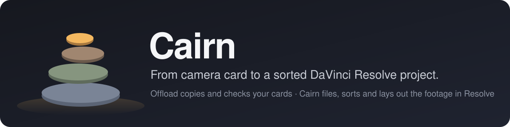
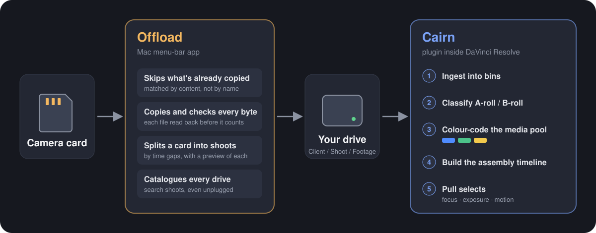
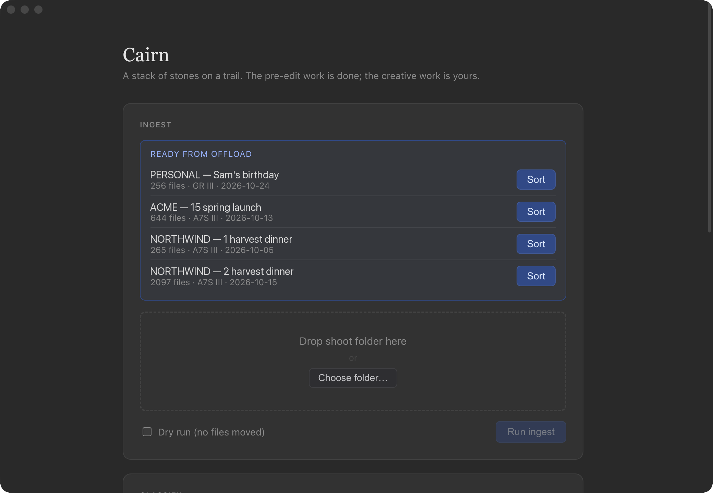
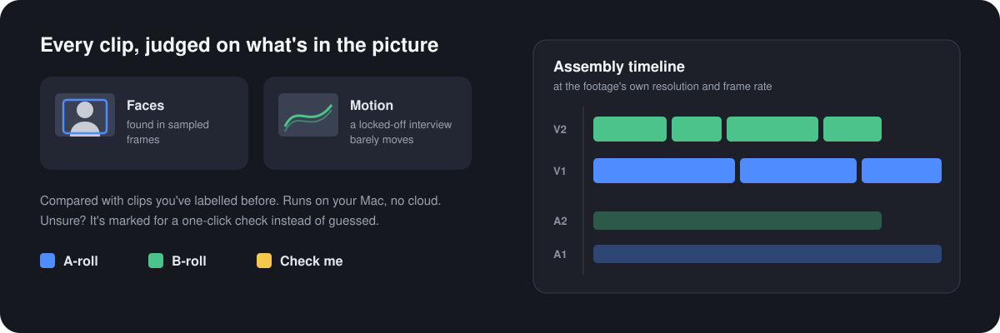
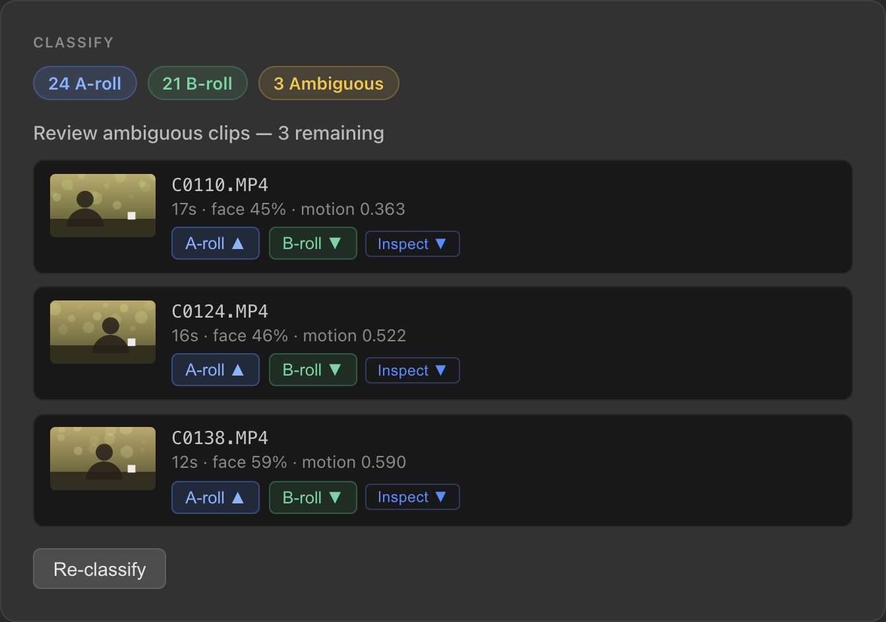
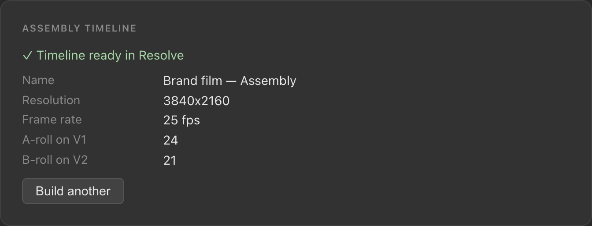
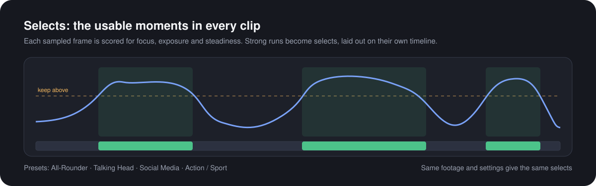
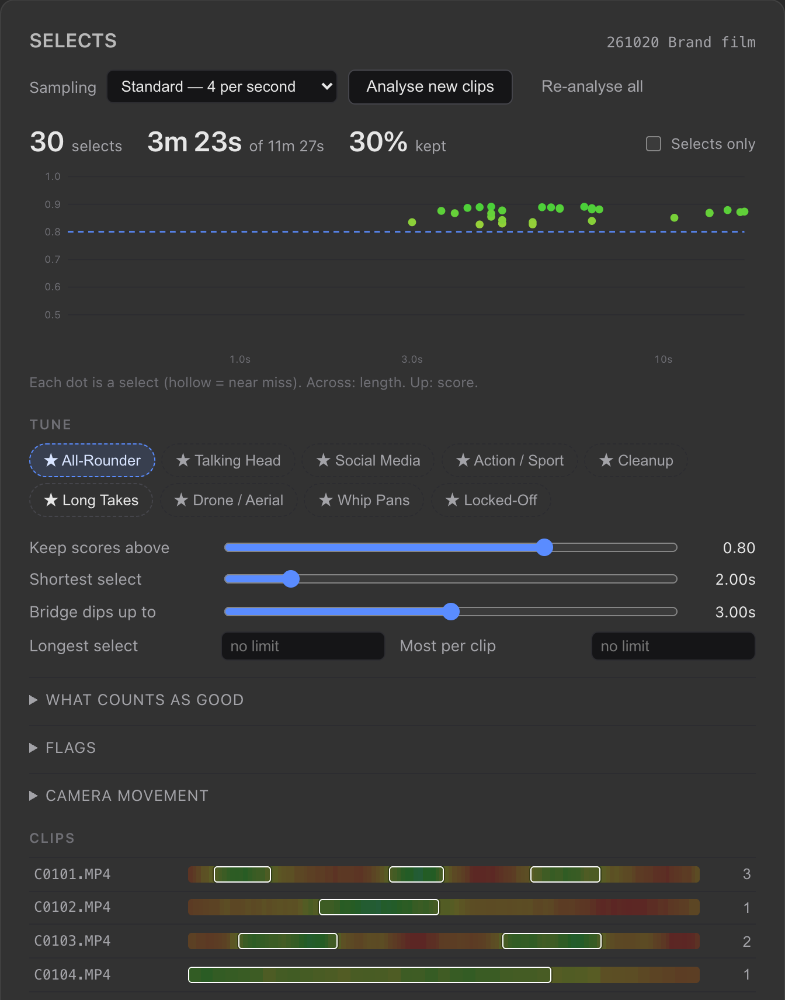

<p align="center">
  
</p>

> _A cairn is a stack of stones left on a trail by someone who walked it first, marking the way for whoever comes next._

Cairn takes the tedious part out of the start of every edit. It's a plugin inside DaVinci Resolve Studio that takes a shoot from your drive, sorts the footage into A-roll and B-roll, colour-codes it, lays out an assembly timeline and pulls the usable moments.

It pairs with **Offload**, a separate Mac menu-bar app (its own repo) that copies your camera cards onto your drive, proves every file arrived intact, and hands each shoot to Cairn. Cairn doesn't need it: any shoot folder works. How the two talk is in [`specs/offload-handoff.md`](specs/offload-handoff.md).

Cairn never cuts your video. It does the logging and the sorting, so you can start on the creative work.

<p align="center">
  
</p>

---

## Cairn: from shoot folder to a ready-to-cut project

Drop a shoot folder (or a shoot Offload just copied) onto the Cairn panel in Resolve.

1. **Ingest.** The footage is organised on disk if it needs to be, and imported into Resolve with a bin per camera.
2. **Classify.** Every clip is sorted into A-roll or B-roll by what's in the picture.
3. **Colour-code.** Clips are coloured in the media pool so you can see the split at a glance.
4. **Build the assembly timeline.** A new timeline at the footage's own resolution and frame rate, with A-roll on V1 and B-roll on V2.
5. **Pull selects.** Every clip is scored for focus, exposure and steadiness, and the strongest moments are laid out on their own timeline.

<p align="center">
  
</p>
<p align="center"><sub>Shoots Offload has copied wait at the top of the panel, one click from being sorted into Resolve.</sub></p>

<p align="center">
  
</p>

Classification runs entirely on your Mac. It samples frames from each clip, looks for faces and measures how much the picture moves (a locked-off interview barely does), then compares the clip with ones you've labelled before. Audio isn't used, because a live mic on the subject during B-roll would fool it. When Cairn isn't sure, it marks the clip yellow for a one-click check rather than guessing.

<p align="center">
  
  
</p>

<p align="center">
  
</p>

Selects needs no AI model: the same footage and settings always give the same selects. Pick one of nine presets (All-Rounder, Talking Head, Social Media, Drone / Aerial, Locked-Off and more), tune it without re-analysing, and build the selects timeline. Optionally, Cairn can learn your taste from the selects you keep, using your own Anthropic API key.

<p align="center">
  
</p>
<p align="center"><sub>The Classify, timeline and Selects screenshots show the real panel running on sample data.</sub></p>

---

## What Cairn will never do

- **Change your footage.** Source media is only ever read.
- **Delete anything outright.** Tidying moves files; it never removes them.
- **Send your footage anywhere.** Classification and selects run locally. The only network call is the optional taste learning, which sends number summaries of the clips you rated, never footage or file names.
- **Store your API key in plain text.** It's kept encrypted with your system keychain.

---

## Getting started

Cairn needs [DaVinci Resolve Studio](https://www.blackmagicdesign.com/products/davinciresolve) with external scripting turned on (Preferences › System › General), Node.js, and Python 3.11 or later.

### Cairn

```bash
npm install
pip install -r src/workers/requirements.txt
npm run install-plugin
```

Restart Resolve, then open **Workspace › Workflow Integrations › Cairn**.

### Tests

```bash
npm test                              # UI and orchestrator (Vitest)
pytest tests/python                   # Python workers
```

---

## Project layout

| Folder              | What's in it                                                                                  |
| ------------------- | --------------------------------------------------------------------------------------------- |
| `src/ui/`           | Cairn's panel inside Resolve (Svelte).                                                        |
| `src/orchestrator/` | The Electron side of the plugin: Resolve API, settings, and the bridge to the Python workers. |
| `src/workers/`      | The Python workers: ingest, classify, timeline, selects.                                      |
| `specs/`            | A detailed spec for each stage.                                                               |
| `packaging/`        | Plugin install and installer builds.                                                          |
| `tests/`            | Vitest and pytest suites.                                                                     |

Built by Aidan Mascaro, a freelance videographer in Perth, WA.
